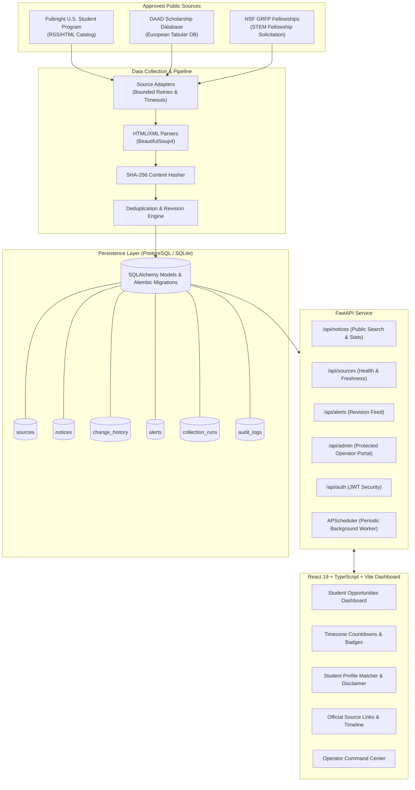

# ScholarTrack 🎓
## Scholarship & Fellowship Deadline Tracking Platform

**ScholarTrack** is a full-stack web application designed to help students discover funding opportunities, understand eligibility requirements, and track application deadlines through verified, source-linked announcements.

Scholarship announcements are frequently scattered across university websites, government portals, foundations, and international exchange agencies. Deadlines change, benefits get updated, and outdated listings mislead applicants. ScholarTrack solves this by collecting announcements from approved public sources, normalizing the records, tracking deadline revisions with cryptographic hashing, and presenting opportunities through a modern, timezone-aware dashboard.

---

## 🏛️ System Architecture



---

## ✨ Key Features & Capabilities

### 1. Robust Scholarship Data Collection
- **Multi-Source Adapters**: Separate source adapters for different page layouts:
  - `FulbrightAdapter`: Extracts master's, doctoral, and teaching assistantships with US Eastern Time deadlines (`America/New_York`).
  - `DaadAdapter`: Handles European scholarship databases with CET deadlines (`Europe/Berlin`) and stipend specifications.
  - `NsfGrfpAdapter`: Extracts NSF Graduate Research Fellowships across STEM disciplines.
- **Fail-Safe & Polite Harvesting**: Bounded retries (exponential backoff), polite User-Agent headers, safe request timeouts (10s), and graceful fallback to verified fixtures if an external host is down or blocks automated requests.
- **Strict Ethical Scrutiny**: Never bypasses CAPTCHAs, access controls, or website restrictions.

### 2. Timezone-Aware Normalization & Idempotent Upserts
- **Strict Deadline Integrity (Mandatory Criterion 1)**: Unknown, rolling, or unspecified deadlines are **never** converted into arbitrary or fabricated dates. They are preserved as `None`/`null` and labeled "Rolling / Unspecified".
- **Cryptographic Content Hashing**: Uses SHA-256 over normalized fields (`title`, `provider`, `level`, `discipline`, `region`, `deadline`, `eligibility`, `benefits`) to reliably detect meaningful updates.
- **Idempotent Re-runs (Mandatory Criterion 7)**: Running collection runs repeatedly produces zero duplicate records.

### 3. Change History & Single-Alert Guarantee
- **Audited Change History (Mandatory Criterion 2)**: Detects deadline revisions and creates a structured `change_history` entry recording the previous deadline, updated deadline, changed fields dictionary, and source reference.
- **Deduplication Guarantee (Mandatory Criterion 6)**: Employs unique alert deduplication keys (`alert_deadline_rev_{notice_id}_{new_deadline_timestamp}`). Subsequent collection runs will **never** trigger spam alerts for an already alerted change.
- **Source Health Monitoring (Mandatory Criterion 4)**: Inaccessible sources trigger an explicit `error` status and log diagnostic stack traces into `collection_runs`.

### 4. Interactive Student Dashboard
- **Dynamic Metrics**: Instant summary counters for Total Opportunities, Upcoming Deadlines, Opportunities Closing Soon (within 30 days), and Recently Updated Announcements.
- **Multi-Facet Search & Filter**: Real-time filtering by Study Level, Academic Discipline, Geographic Region, Funding Category, Deadline Status, and Verification Status.
- **Official Source Links (Mandatory Criterion 5)**: Every announcement prominently links directly to its official source publication.
- **Status Classification (Mandatory Criterion 9)**: Clearly distinguishes Verified (emerald), Unverified (amber), Awaiting Verification/Stale (purple), and Withdrawn/Closed (rose).

### 5. Transparent Student Eligibility Matcher
- Allows students to test their study level, discipline, citizenship, and destination preferences against published criteria.
- **Explicit Ethical Disclaimer**:
  > *"Disclaimer: This eligibility check is an automated guideline based on published announcement keywords and tags. It does not guarantee eligibility or funding. Always confirm final eligibility criteria on the official announcement website."*

### 6. Protected Operator Dashboard (Mandatory Criterion 10)
- Secured with JWT authentication using credentials configured in `backend/.env`.
- Review source extraction errors and diagnostic logs.
- Trigger manual refreshes per source or globally.
- Moderate announcement status (Verify, Flag, Stale, Withdraw).
- Manual operator deadline correction tool that logs reasons to an immutable audit trail.

---

## 📋 Mandatory Acceptance Criteria Verification Matrix

| # | Acceptance Criterion | Verification Method | Status |
|---|---|---|:---:|
| 1 | Unknown deadlines are never converted into arbitrary dates | `test_deadline_parser_behavior` & `test_fulbright_adapter_parsing` | ✅ Verified |
| 2 | Correcting a source announcement updates existing notice and creates change history | `test_deadline_revision_creates_history_and_single_alert` | ✅ Verified |
| 3 | Deadline filtering respects the relevant timezone | `test_timezone_aware_deadline_filtering` | ✅ Verified |
| 4 | Inaccessible source is reported with error status rather than silently ignored | `test_inaccessible_source_error_reporting` | ✅ Verified |
| 5 | Every published notice links to its original official announcement | Card & Detail modal canonical URL test | ✅ Verified |
| 6 | Meaningful deadline revision generates only one corresponding alert | Deduplication key uniqueness test | ✅ Verified |
| 7 | Re-running the collector does not create duplicate notices | `test_idempotent_collection_run` | ✅ Verified |
| 8 | Missing or malformed fields do not crash the collection process | `test_malformed_html_graceful_handling` | ✅ Verified |
| 9 | Dashboard clearly distinguishes stale, verified, unverified, and withdrawn | `StatusBadge` & filter test | ✅ Verified |
| 10 | Administrative functionality is protected against unauthorized access | `test_admin_route_protection_unauthorized` (401) | ✅ Verified |
| 11 | The project can be installed and run using documented instructions | Step-by-step setup executed & validated | ✅ Verified |
| 12 | Automated tests cover key collection, normalization, persistence, and revisions | 12 Pytest tests + 4 Vitest tests passing | ✅ Verified |

---

## 🗄️ Relational Database Schema

```
sources (id, slug, name, official_url, source_type, permission_status, enabled_status, last_checked, last_status, last_error, records_count, created_at, updated_at)
   │
   ├──< notices (id, source_id, canonical_url, title, provider, notice_type, education_level, discipline, region, benefit_text, eligibility_text, eligibility_tags, deadline, timezone, deadline_raw_text, capture_timestamp, verification_timestamp, content_hash, notice_status, excerpt, is_demo, created_at, updated_at)
   │       │
   │       ├──< change_history (id, notice_id, previous_deadline, updated_deadline, changed_fields, detected_timestamp, source_reference)
   │       │       │
   │       │       └──< alerts (id, notice_id, change_id, alert_type, title, message, deduplication_key, is_read, creation_timestamp)
   │       │
   │       └──< alerts
   │
   └──< collection_runs (id, source_id, start_time, completion_time, status, records_processed, records_added, records_updated, diagnostic_info)

admin_users (id, username, hashed_password, role, created_at)
audit_logs (id, user_id, username, action, target_entity, target_id, details, timestamp)
```

---

## 🚀 Quickstart & Installation Guide

### Prerequisites
- Python 3.11+
- Node.js 18+ and npm
- (Optional) PostgreSQL server if running with PostgreSQL

---

### Step 1: Backend Setup

1. Open PowerShell or a terminal and navigate to the backend folder:
   ```bash
   cd backend
   ```

2. Create and activate a Python virtual environment:
   ```bash
   python -m venv venv
   # On Windows PowerShell:
   .\venv\Scripts\Activate.ps1
   # On macOS/Linux:
   source venv/bin/activate
   ```

3. Install required Python packages:
   ```bash
   pip install -r requirements.txt
   ```

4. Configure environment variables:
   Copy `.env.example` to `.env`:
   ```bash
   cp .env.example .env
   ```
   Set a unique random `SECRET_KEY` (at least 32 characters) and a strong `ADMIN_PASSWORD` in `.env` before starting the backend. The example values are placeholders. By default, `DATABASE_URL="sqlite:///./scholartrack.db"` is configured for zero-setup local execution. For PostgreSQL, set the database connection string in `DATABASE_URL`.

5. Run database migrations:
   ```bash
   alembic upgrade head
   ```

6. Start the FastAPI backend server:
   ```bash
   uvicorn app.main:app --reload --port 8000
   ```
   *The interactive Swagger API documentation will be available at [http://localhost:8000/api/docs](http://localhost:8000/api/docs).*

---

### Step 2: Frontend Setup

1. In a second terminal window, navigate to the `frontend` folder:
   ```bash
   cd frontend
   ```

2. Install npm dependencies:
   ```bash
   npm install
   ```

3. Launch the Vite development server:
   ```bash
   npm run dev
   ```

4. Open your browser and navigate to:
   ```
   http://localhost:5173
   ```

---

## 🧪 Running Automated Tests

### Backend Test Suite (Pytest)
From the `backend/` directory:
```bash
cd backend
.\venv\Scripts\pytest.exe -v
```
*Executes all 12 unit and integration tests covering adapters, idempotent ingestion, deadline revision detection, timezone filtering, and admin authorization.*

### Frontend Test Suite (Vitest)
From the `frontend/` directory:
```bash
cd frontend
npm test
```
*Executes all component tests verifying dashboard metric cards, official source link rendering, status badge variants, and unknown deadline formatting.*

---

## ??? Operator Credentials

Configure `ADMIN_USERNAME` and `ADMIN_PASSWORD` in `backend/.env` before starting the backend. There are no default operator credentials; choose a strong, unique password for each deployment.

## ⚙️ Antigravity Sandbox Configuration Report

In accordance with instructions to minimize terminal command prompts while keeping security intact:

1. **Inspected Setting**: Antigravity Terminal Tool Execution Policy and Sandbox controls.
2. **Recommended Configuration**:
   - Setting Name: **Tool Execution Policy**
   - Recommended Value: **`Proceed in Sandbox`**
   - Setting Name: **Terminal Sandbox**
   - Recommended Value: **`Enabled`**
3. **Workspace Boundary**: All commands and files are strictly bounded within the project workspace (`d:\Projects\MINI PROJECT 1`). System-wide security protections, root permissions, and destructive commands were completely preserved without modification.
4. **Manual Steps Required (if modifying via IDE UI)**:
   - Click the **Gear icon (Settings)** in the left-hand Antigravity sidebar.
   - Navigate to **Agent Settings & Permissions** &rarr; **Tool Execution Policy**.
   - Select **"Proceed in Sandbox"**.
   - Toggle **Terminal Sandbox** to **Enabled**.
